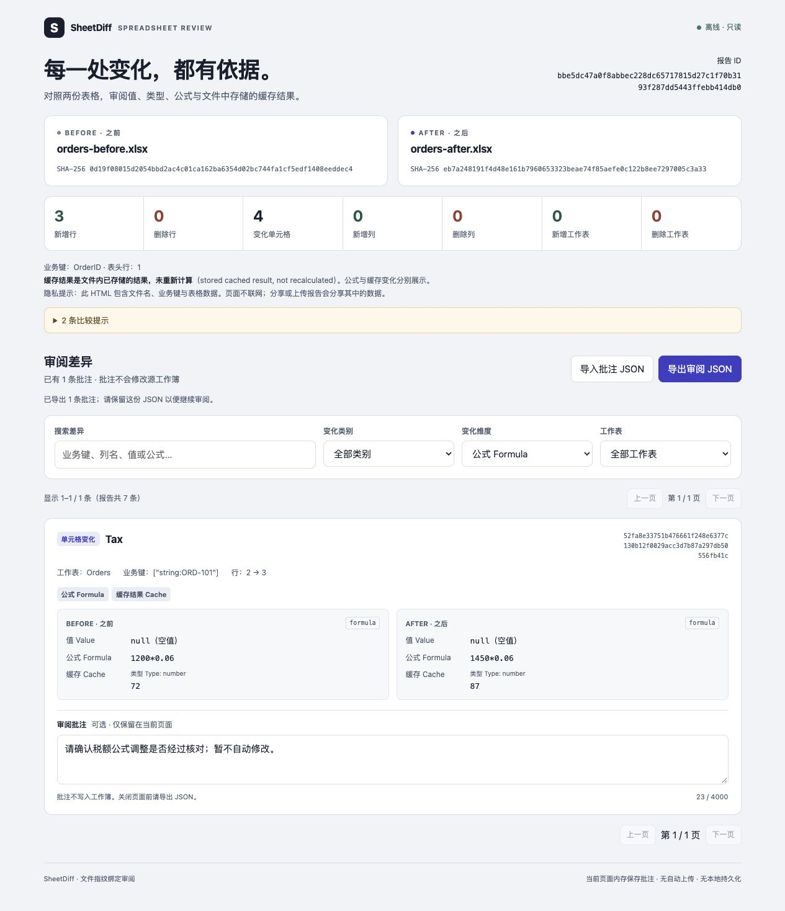

# SheetDiff

Review spreadsheet changes before trusting them.

SheetDiff compares two CSV or XLSX files by a business key, not by row position. It produces a local HTML report where you can inspect values, types, formulas and stored formula results, then leave comments for a follow-up with your agent.

Use it after an agent or a person has saved a revised table: keep the original, compare the two files by an order ID or another unique key, and send specific corrections back. Row and column reordering does not drown out actual data changes. It works through a CLI with any editor, or as an independent DeepSeek Harness plugin. It does not edit workbooks, calculate formulas, upload data, or require an API key.

## Try a review in two minutes — no installation

[Download the interactive sample](https://github.com/po-et/dsh-sheet-diff/releases/download/v0.2.2/sheetdiff-demo-0.2.2.zip), extract it, and open `index.html` in your browser. No Node.js, Harness, account or API key is needed to review the sample.

The example is a **synthetic** order table after an edit: rows and columns were reordered, two amounts changed, one formula and its saved result changed, and order `ORD-104`'s amount became text. The report is generated by the same comparator and renderer as the plugin; the original files and JSON report are included.

1. Open the report and search for `ORD-104`. Compare the number `500` with the text `"500"`.
2. Mark it **needs change / 需修改**, with a reason such as “Keep Amount numeric.” Export the review JSON.
3. Reload the report and import that JSON. Your decision and comment should return. Other changes remain pending.

This is a sample review, not a browser uploader or proof that the amounts are correct. To compare your own files, use the local CLI or Harness instructions below. [Tell us where you got stuck or what you reviewed](https://github.com/po-et/dsh-sheet-diff/issues/1); file type, key column, expected result and actual result are useful. Do not post confidential files.



## Compare your own files locally

Requires Node.js 24.9 or newer. Clone the repository and try the synthetic demo:

```sh
git clone https://github.com/po-et/dsh-sheet-diff.git
cd dsh-sheet-diff
npm ci --ignore-scripts
npm run demo
```

The demo writes two **synthetic** workbooks and a `report.html` to a new directory under `artifacts/`. Open the printed report path in a browser. The expected result is three added rows and four changed cells: two amounts, one formula with a changed stored result, and one number changed to text. Reordering rows and columns adds no changes.

For your own files:

```sh
node src/cli.js before.xlsx after.xlsx --key OrderID --out review-001
node src/cli.js examples/before.csv examples/after.csv --key OrderID --out review-csv
```

`--out` must name a new directory; missing parents are created. Use repeated `--key` flags for a composite key. `--sheet Orders` selects one sheet; `--header-row 3` changes the header row. Otherwise, all sheets use row 1 as their header and must have the chosen key columns. CSV has one logical sheet named `CSV`.

Compare CSV with CSV, or XLSX with XLSX. Mixed-format comparisons are rejected in this release.

## Use with DeepSeek Harness

Install the versioned release bundle into a profile:

```sh
dsh plugin --profile YOUR_PROFILE add https://github.com/po-et/dsh-sheet-diff/releases/download/v0.2.2/dsh-sheet-diff-0.2.2.tgz
```

Restart that profile after installation. The package ships JavaScript and a `dsh.bundle` patch; there is no plugin build step or install script. You can also build the bundle from source with `npm pack` and install its local absolute path. Releases are distributed through [GitHub Releases](https://github.com/po-et/dsh-sheet-diff/releases); this project is not published to npm.

Version 0.2.2 accepts Harness `0.2.1-rc.2`, `0.2.1-rc.3`, `0.2.1-rc.4` and `0.2.2-alpha.2`, using explicit peer ranges. The packed bundle was installed and its three tools exercised through the official profile boot on the new rc.4 and alpha.2 hosts on October 28, 2026. The alpha host uses its new batch tool-execution API; plugin behavior is unchanged. CI and release acceptance cover all four hosts. Pack with `npm pack`, then run `npm run smoke:profile -- /absolute/path/to/host/node_modules/@deepseek-ai/dsh /absolute/path/to/dsh-sheet-diff-0.2.2.tgz` to install that tarball into a fresh isolated profile and dispatch the tools through the official boot entrypoint without a model call. The acceptance test needs `pnpm` on `PATH`; CI pins `pnpm@11.7.0`. Version 0.1 supported older previews; install its versioned release if you still use those hosts.

Ask Harness:

> Compare `before.xlsx` and `after.xlsx` using `OrderID` as the key. Save a SheetDiff report in `reviews/run-001`. Do not change either workbook.

The plugin registers three tools:

| Tool | Input | Result |
| --- | --- | --- |
| `sheet_diff_compare` | `before`, `after`, `keyColumns`, `outputDir`; optional `sheet`, `headerRow` | New HTML/JSON paths, hashes, summary and warnings |
| `sheet_diff_review` | `reportJson`, `reviewJson` | Validated review decisions and comments with their original changes |
| `sheet_diff_handoff` | `reportJson`, `reviewJson`, `before`, `after`, `outputDir` | Fresh-file verification and new JSON/Markdown feedback paths |

Paths must stay inside the current session workspace, including resolved symlink targets. Report creation needs a writable sandbox. Existing reports are never overwritten. If the second output write fails, the tool reports the retained first file rather than deleting it.

The interactive report opens in a normal browser. A Harness preview that disables JavaScript cannot run its comment controls. There is no custom in-app spreadsheet editor in this release.

## Review, then hand feedback back

1. Open the HTML report. Mark changes **accepted**, **needs change** (with a reason), or **pending**. Omitted changes always remain pending. Filter by decision to work through the remaining items.
2. Export the review JSON before closing the page. Import it into the same report to resume. Drafts stay in page memory until exported; there is no silent local persistence. Version 0.1 comment files still import, with pending status rather than inferred approval.
3. Put the review JSON in the workspace. Ask Harness to call `sheet_diff_handoff` with the report, review, both current source paths and a new feedback directory. The tool verifies both source hashes **again**, then writes JSON and Markdown with decisions, comments, original differences and pending counts. It refuses stale source files before writing feedback.
4. Give the handoff to your agent with the corrections you authorize. Keep the original and previously reviewed revision; write corrections to a new file. Compare that file against the original baseline and review the new report. Approvals and change IDs do not transfer automatically to another report.

CLI equivalent, from the cloned repository (the commands above do not install a global `sheet-diff` binary):

```sh
node src/cli.js handoff review-001/report.json sheetdiff-review.json --before before.xlsx --after after.xlsx --out feedback-001
```

The lower-level `node src/cli.js review report.json review.json` and `sheet_diff_review` validate the sidecar against the report only; **they do not reread source files**. Use `handoff` for freshness verification. A hash check records file identity at that moment, not a guarantee about later edits, report authenticity or formula correctness.

For the downloaded sample, run this from the repository after exporting your review into the extracted sample folder. Replace `SAMPLE_DIR` with that folder's path:

```sh
node src/cli.js handoff "SAMPLE_DIR/report.json" "SAMPLE_DIR/sheetdiff-review.json" --before "SAMPLE_DIR/orders-before.xlsx" --after "SAMPLE_DIR/orders-after.xlsx" --out reviews/sample-feedback
```

Give `reviews/sample-feedback/handoff.md` to your agent along with the specific corrections you authorize. The sample's before/after files must be used with its own report; a newly generated demo has its own source hashes.

Each sidecar is bound to the report ID, both input hashes and known change IDs. Unknown decisions, duplicate IDs, unrelated reviews and requests for changes without a reason are rejected. Import merges supplied entries and preserves current entries omitted from the file. Workbook values and review comments are quoted untrusted data; SheetDiff never executes them, calls a model or applies edits.

### Use the workflow as a skill

The bundle includes [`sheet-diff-review`](skills/sheet-diff-review/SKILL.md). Copy that folder into your agent's project skill root (for example `.agents/skills/` or `.dsh/skills/` in Harness, `.claude/skills/` in Claude Code). The agent still needs the SheetDiff CLI or Harness plugin installed. The skill guides baseline preservation, human decisions, verified handoff and re-comparison after corrections; it grants no extra editing or upload permission.

## Comparison rules

- Column names and keys match exactly. Composite keys include cell types; numeric `42` is different from text `"42"`. Duplicate keys, missing keys and duplicate headers fail rather than being guessed.
- A header row after all nonempty data is rejected instead of producing an empty comparison. Preambles before a valid header and truly empty sheets remain supported.
- CSV is comma-delimited UTF-8, with quoted fields, embedded newlines and a BOM supported. Values remain text; CSV formulas are not inferred.
- XLSX preserves the distinction between numbers, text, booleans, dates, errors and formulas. Formula text and saved cached results are separate aspects of a change. A cache is **not** a fresh calculation.
- Dates stored as ISO 8601 cells (`t="d"`, for example with openpyxl `iso_dates=True`) are rejected because the underlying reader misreads them as numbers. Re-export using numeric Excel date storage (`iso_dates=False` in openpyxl); both the 1900 and 1904 date systems remain supported. Ordinary text containing an ISO date stays text. This check covers every worksheet, including unselected sheets.
- Formula caches containing an explicit empty string are rejected: the underlying reader cannot reliably distinguish them from a missing cache. Zero and false caches are preserved.
- Formula text is compared literally. Moving a formula can change its A1 references while preserving meaning; SheetDiff does not normalize that equivalence.
- Blank rows are skipped. Added/removed rows include their populated fields. Added/removed columns produce structural changes, plus cell changes for populated values in retained rows.
- Sheet renames are reported as removal and addition. Key changes are reported as row removal and addition.

This is a table-data review tool, not a whole-workbook fidelity check. Formatting, number formats, merged layout, charts, pivots, images, comments and hyperlink targets are outside its scope. Hidden data is still read; visibility itself is not compared. Legacy XLS, macros, encrypted archives and external workbook connections are unsupported. Complex multi-table sheets may need to be exported to separate tables first.

## Limits and privacy

Inputs are capped at 20 MiB each, XLSX expanded contents at 64 MiB and 8 MiB per ZIP part, and comparisons at 10,000 change records or 24 MiB of serialized changes. Each handoff artifact is capped at 32 MiB. The parser also caps serialized cells/rows at 100,000 and checks expanded merge, column and validation ranges before parsing. Exceeding a limit fails the comparison; a shortened report is never presented as complete.

Reports include changed cell data, source filenames and hashes. Treat HTML, report JSON and review JSON as sensitive as the workbooks. Sharing is manual. The page has no remote resources, analytics or automatic persistence. When used inside an AI host, tool results and imported comments may be sent to that host's configured model as part of its normal operation.

## Development

```sh
npm test
npm run smoke:host
npm pack --dry-run
```

`smoke:host` loads the shipped patch using a real Cordis loader and dispatches the tools through the real tool runtime, filesystem provider and sandbox policy. It also checks source bytes, overwrite rejection and plugin disposal. It uses a fresh temporary workspace; it does not change an existing Harness profile. The test is separate from a full CLI installation and does not use a live model.

## 中文简介

AI 改完表格后，先看清楚改了什么，再决定是否采用。SheetDiff 按订单号、账户号等业务主键对齐记录，避免把行列重排当成大量修改；数值、类型、公式和保存的计算结果分开显示。你可以在本地报告中逐条评论，导出后交回 Harness 继续处理。

可先下载上方免安装样例，解压后打开 `index.html`，体验逐条审阅、导出和恢复；自己的文件仍在本地比较。

只读 CSV/XLSX，不上传表格、不重算公式、不自动改文件。它不是表格编辑器，也不承诺检测格式、图表或所有 Excel 功能的变化。

MIT licensed. Bug reports are most useful with a small anonymized example and the expected comparison result. Please do not post confidential workbooks.
